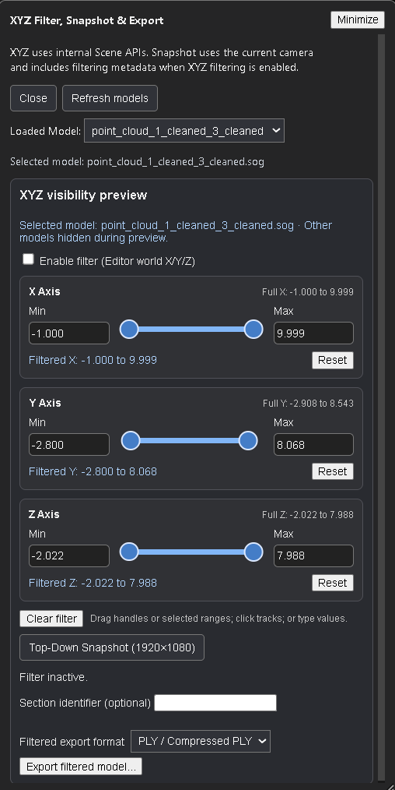
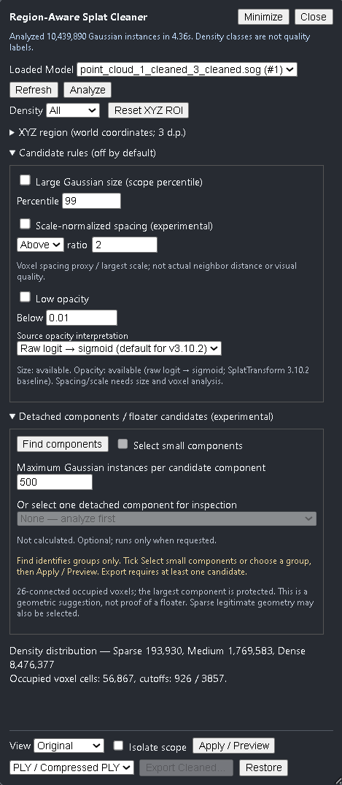
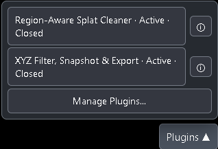
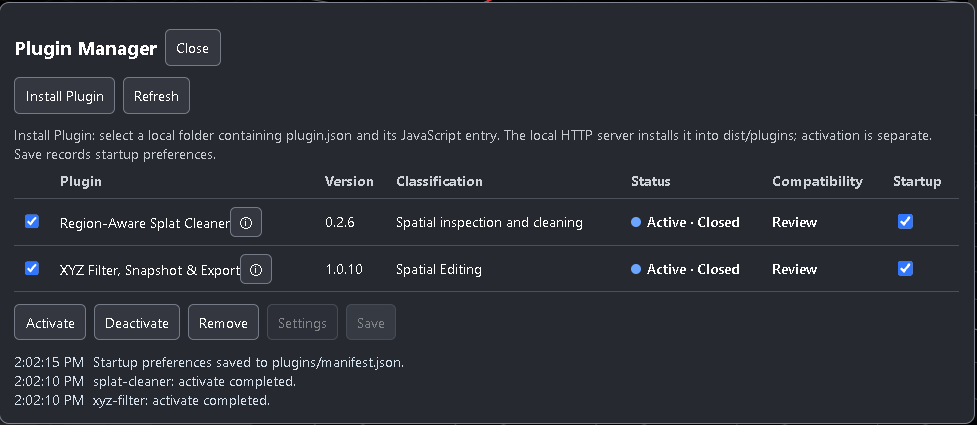

# SuperSplat Plugin Manager

A lightweight extension framework for [PlayCanvas SuperSplat Editor](https://github.com/playcanvas/supersplat). Plugins can be installed and updated **without modifying upstream TypeScript or rebuilding the Editor for each plugin change**.

Two independent plugins demonstrate the framework:

- **XYZ Filter, Snapshot & Export** — Coordinate-based 3DGS filtering, orthographic snapshots, selective export, and transformation-aware metadata.
- **Region-Aware Splat Cleaner** — 3DGS cleanup using Scale-Normalized Spacing (SNS), SplatTransform GPU Floaters, and complementary cleaning rules.

**Versions:** Plugin Manager **v1.11** · XYZ Filter **v1.0.10** · Splat Cleaner **v0.3.1**.  
**Editor references:** Manager reviewed against SuperSplat **v3.7.0** and **v3.8.0**. These are compatibility references, not mandatory version locks.

## Architecture

SuperSplat's **original static server** serves the Editor and installed plugins. A separate **Node.js management backend** installs/removes packages and saves settings. The browser-side Manager controls activation, UI, and runtime status.

| Component | Location |
|---|---|
| Browser Manager | `plugin-manager/custom-editor.js` → `supersplat/dist/custom-editor.js` |
| Management backend | `supersplat/dist/runtime/management-server.cjs` |
| Installed plugins and manifest | `supersplat/dist/plugins/` |

Both servers share the plugin directory **without direct server-to-server communication**. The browser accesses each service separately. No duplicate Editor installation is needed.

The Manager supports **Install, Activate, Open, Deactivate, Remove**, persistent **Settings/Startup**, and **Refresh** to recover backend management capabilities after a restart. Update plugins through **Remove → Install**. Compatibility checks are advisory; each plugin remains responsible for its own runtime compatibility.

## XYZ Filter — Reference Plugin

**XYZ Filter v1.0.10** operates on one selected model at a time:

- **XYZ ranges and reversible preview:** Filter in Editor-world coordinates; opening the plugin starts preview and temporarily isolates other models. **Clear filter** restores full ranges and visibility without ending preview; **Restore and close** ends preview.
- **Export:** Save filtered PLY, compressed PLY, SPLAT, SOG, or SPZ with an `.export.json` report.
- **Snapshots:** Export orthographic PNG/JSON with camera/projection and applicable section metadata. The main-panel snapshot is unfiltered.
- **Traceability:** Record supported post-load transformations and model metadata where reliable.

With multiple loaded models, select the target explicitly. **Activate XYZ before model import** when transformation tracking is required. Restore and close preview before switching targets. XYZ does not perform image registration or provide transformation controls.

## Region-Aware Splat Cleaner

**Splat Cleaner v0.3.1** provides an independent cleanup and export workflow:

- **SNS (CPU):** Tests Gaussian-center spacing relative to each splat's scale and orientation. It is a geometric outlier detector, **not** a rendering-quality measurement.
- **GPU Floaters:** Separate SplatTransform **v3.11.1** analysis using a bundled browser runtime.
- **Other rules and scope:** Size, Opacity, and other candidate rules; XYZ region and density scope restrict which candidates are selected. Enabled rule masks combine using **OR**.

SNS parameters balance cleaning strength:

| Parameter | Default | Effect when increased |
|---|---:|---|
| Extent `k` (1–5; step 0.5) | **3** | Larger neighborhood; **fewer or equal** SNS candidates |
| Minimum neighbors `m` (1–10) | **1** | Greater support requirement; **more or equal** SNS candidates |

Start with **`k=3, m=1`**. Increase `k` to preserve sparse detail; decrease `k` or increase `m` for stronger pruning. Changing `k`/`m` requires **Analyze SNS** again, but does not invalidate independent GPU analysis. Changing both has no predetermined net effect.

**Workflow:** Select model → **Analyze** → **Analyze SNS** (and GPU Floaters if needed) → enable rules and optional scope → **Apply / Preview** → inspect **Original / Candidates / Cleaned** → **Restore** or **Export Cleaned**. Analyses are cached independently; preview is temporary and export writes a new retained-splat model.

**Limits:** Clustered or very large floaters can survive SNS; sparse legitimate details can be selected. Opacity/Size rules may find additional artifacts but cannot automatically protect SNS false positives under OR composition. Inspect candidates before export. In v0.3.1, GPU Floater analysis is temporarily limited to **2 million instances**; CPU SNS has no equivalent fixed cap. WebGPU device-loss errors can require an Editor reload.

## Installation and startup

**Prerequisites:** Node.js with npm, Git for initial checkout, and a browser compatible with the selected Editor and plugin features.

### 1. Arrange release files

Extract the Manager, XYZ Filter, and **complete installable** Splat Cleaner packages into one project root, alongside the supplied Windows maintenance scripts. Required directory layout:

~~~text
release_plugin_manager_v1.11/
├── plugin-manager/
├── xyz-filter/
├── splat-cleaner/
├── supersplat/                 # created by clone or existing checkout
├── maintain_editor.bat
├── maintain_editor.ps1
├── deploy_runtime.ps1
├── run_supersplatEditor_p3013.bat
└── stop_supersplatEditor_p3013.bat
~~~

Splat Cleaner must include its compiled `vendor/splat-transform-filter.mjs`. If using a **source-only ZIP**, build the plugin release first; Plugin Manager does not compile npm dependencies. Install plugin folders through the Manager UI, **not** by copying them into `dist/plugins/`.

### 2. Build and start

From the project root (Windows examples):

~~~powershell
.\maintain_editor.bat clone    # first checkout only
.\maintain_editor.bat build    # builds Editor and deploys Manager
.\run_supersplatEditor_p3013.bat
# To stop: .\stop_supersplatEditor_p3013.bat
~~~

Alternatively, start both services separately:

| Service | Working directory | Command |
|---|---|---|
| Editor static server | `supersplat/` | `npm run serve -- -l tcp://127.0.0.1:3013 --no-port-switching` |
| Management backend | Project root | `node ./supersplat/dist/runtime/management-server.cjs --dist ./supersplat/dist --port 3014 --editor-origin http://127.0.0.1:3013` |

Open **http://127.0.0.1:3013/**. Ports are examples. When changing them, update both backend `--editor-origin` and the Editor HTML hook's `data-management-origin`. Starting services does not build the Editor or activate plugins; saved **Startup** activates plugins when the browser page initializes.

### 3. Install plugins

Open **Plugins → Manage Plugins → Install Plugin**, select the complete plugin folder, then **Activate**. Optionally enable **Startup** and **Save**; open the plugin from the **Plugins** menu. Plugin-only updates require **no Editor rebuild**.

## Maintenance and limitations

| Task | Procedure |
|---|---|
| Rebuild Editor and deploy Manager | `maintain_editor.bat build` |
| Update Manager only | `maintain_editor.bat copy` |
| Update plugin | **Deactivate → Remove → Install → Activate** |
| Restore management operations | Restart backend → **Refresh** |

Removal resets saved plugin settings and Startup preferences. If browser cleanup is uncertain, reload the Editor before reactivating a replacement. Install/Save/Remove need the backend; already installed plugins can run from the static server without it.

**Security and compatibility:** Use trusted plugins, keep the management backend on a trusted local machine, and keep secrets/logs outside served `dist/`. Internal Editor APIs and browser/WebGPU behavior may change between releases. Verify plugin-specific behavior after Editor upgrades.

**Project scope:** Reusable SuperSplat extension infrastructure, demonstrated by independently maintained 3DGS inspection and cleanup plugins.
