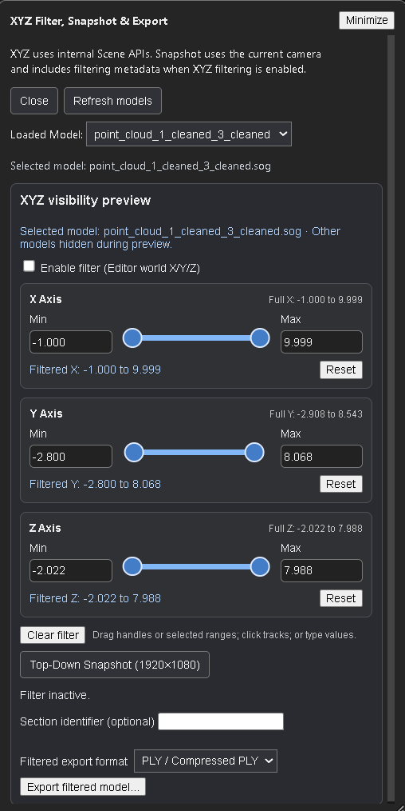
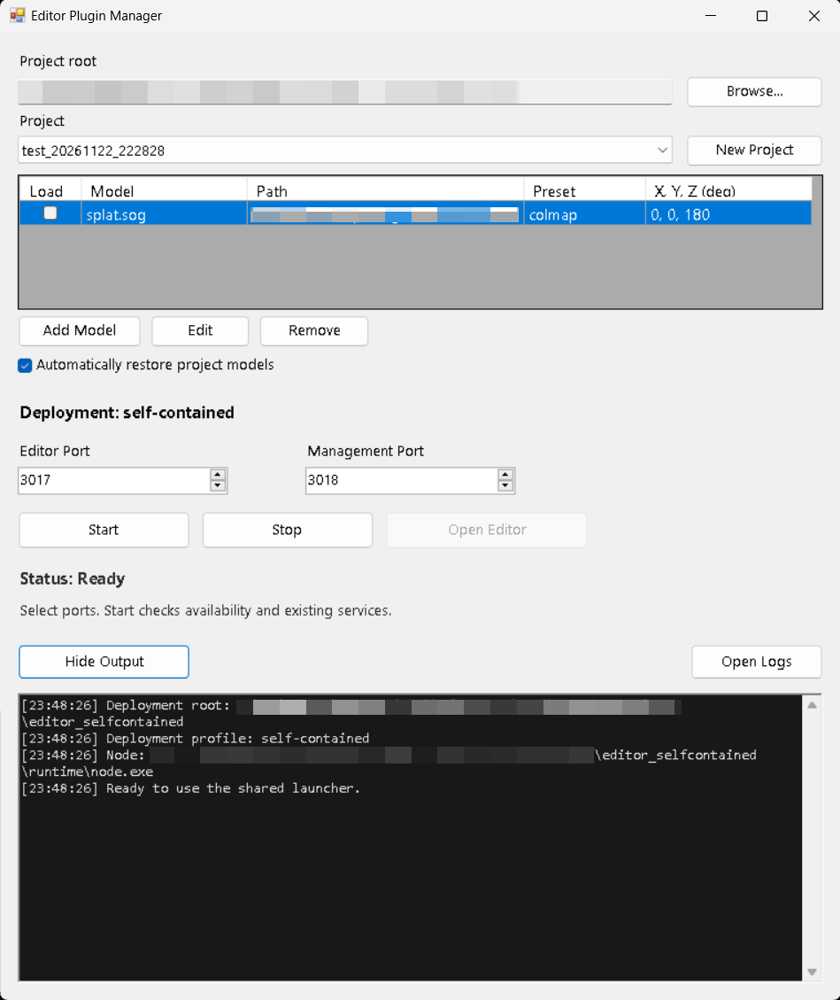

# Editor Plugin Manager v1.13.3

A lightweight extension framework for [PlayCanvas SuperSplat Editor](https://github.com/playcanvas/supersplat), enabling independent plugin development and management **without modifying upstream TypeScript or rebuilding the Editor for each plugin update**.

**Plugin Manager:** v1.13.3  
**Reference plugins:** XYZ Filter v1.0.10 · Splat Cleaner v0.3.37  
**Editor references:** SuperSplat v3.7.0–v3.9.2

## Motivation

Specialized 3D Gaussian Splatting (3DGS) workflows often require additional inspection, filtering and processing tools.

Direct integration into the Editor source increases maintenance effort as upstream development evolves.

Editor Plugin Manager separates plugin development and management from the upstream Editor, improving maintainability, software reuse and implementation flexibility.

## Features

- **Independent plugins:** Install, configure, activate, remove and update plugins without rebuilding the Editor.
- **Persistent configuration:** Manage plugin settings and automatic startup.
- **Native software integration:** Extend browser functionality using system-installed or bundled CLI tools, libraries and processing scripts.
- **Managed native execution:** Authorization, port assignment, process lifecycle and resource cleanup coordination.
- **Reusable architecture:** Develop specialized plugins through common integration and lifecycle interfaces.

## Architecture

~~~mermaid
flowchart TB
    A["SuperSplat Editor + Plugins"]
    B["Original Static Server"]
    C["Independent Management Backend"]
    D["Shared Plugin Directory"]
    E["Optional Plugin-Owned Native Service"]
    F["System CLI / Libraries / Scripts"]

    B -->|"Serves"| A
    A -->|"Management API"| C
    B -->|"Reads"| D
    C -->|"Reads / Writes"| D
    C -->|"Managed lifecycle"| E
    A -->|"Plugin-specific requests"| E
    E --> F
~~~

The original Editor server remains independent of the management backend.

Plugins can operate entirely within the browser or integrate native processing through their own local services. Plugin Manager handles common infrastructure rather than plugin-specific computation.

This allows existing software to complement browser-based visualization without unnecessary reimplementation.

## Reference Plugins

### XYZ Filter, Snapshot & Export

Coordinate-based filtering and spatial inspection of 3DGS models.

- Interactive XYZ filtering with reversible preview.
- Selective model export.
- Orthographic snapshots with camera and section metadata.
- Transformation-aware export reports.

### Region-Aware Splat Cleaner

Interactive 3DGS cleaning through complementary detection methods.

- **SNS:** Bidirectional, scale-normalized geometric-support detection.
- **GPU Floaters:** Contribution-based filtering using configured SplatTransform.
- **Additional rules:** Size, Opacity and detached components.
- **Region-aware selection:** XYZ bounds and density scope.
- **Visual inspection:** Original, Candidates and Cleaned views, with individual Method Tint.
- **Selective export:** Retained Gaussians with a JSON cleaning report.

## Installation and Startup

**Requirements:** Windows PowerShell, a compatible browser, and the Node.js/runtime dependencies required by the selected deployment profile. Git is required for the initial Editor checkout in the standard source deployment.

The Unified Launcher supports two deployment profiles:

| Profile            | Description                                                        |
| ------------------ | ------------------------------------------------------------------ |
| **Standard**       | Existing SuperSplat source/build installation with system Node.js. |
| **Self-contained** | Deployment with packaged Node.js and runtime dependencies.         |

Select the appropriate profile in `launcher_config.json` before startup. The supplied example configuration defaults to `self-contained`.

### 1. Prepare the Editor

For the standard source/build deployment, prepare the Editor from the project root:

~~~powershell
.\maintain_editor.bat clone
.\maintain_editor.bat build
~~~

Clone is required only for the initial checkout.

For an existing compatible Editor build, deploy Manager without rebuilding:

~~~powershell
.\maintain_editor.bat copy
~~~

Portable and self-contained deployments use their prepared Editor distribution and configured runtime dependencies.

### 2. Start the Editor

The recommended startup method is **Unified Launcher GUI**.

#### Option A — Unified Launcher GUI (Recommended)

From the launcher deployment directory:

~~~powershell
.\EditorPluginManager.bat
~~~

The launcher provides:

- Editor and Management service startup and shutdown.
- Configurable Editor and Management ports.
- Standalone Editor operation.
- Project creation and selection.
- Model registration and optional restoration.
- Service status, runtime output and diagnostic logging.

For ordinary Editor operation:

1. Select **(Standalone)**.
2. Confirm the configured ports.
3. Click **Start**.
4. Open the Editor using **Open Editor**.
5. Click **Stop** for controlled shutdown.

#### Optional Project Restoration

The Unified Launcher can also organize registered models by project.

1. Select a project root and create or select a project.
2. Use **Add Model** to register model files and import rotations.
3. Select the models to restore using their **Load** checkboxes.
4. Enable **Automatically restore project models**.
5. Click **Start** to launch the Editor and restore the enabled models.

Project definitions are stored in `project.json`.

The launcher uses Project Restoration v0.1.5 and can automatically provision the bundled restoration plugin through Plugin Manager when required. 

Project restoration imports registered model files and applies their configured orientations. It does not restore the complete Editor scene, editing history or camera state.

For operation without automatic model loading, select **(Standalone)** or disable automatic restoration.

#### Option B — Standalone BAT Startup

Start the Editor directly:

~~~powershell
.\start.bat
~~~

Optionally specify Editor and Management ports:

~~~powershell
.\start.bat 3013 3014
~~~

Press any key in the startup terminal to initiate shutdown, or run:

~~~powershell
.\stop.bat
~~~

The BAT startup operates in standalone mode and does not automatically restore the project selected in the GUI.

Direct Node.js launcher commands, deployment configuration and detailed project restoration procedures are documented in the Unified Launcher README.

### 3. Install Plugins

1. Open **Plugins → Manage Plugins → Install Plugin**.
2. Select the extracted plugin folder.
3. Activate the plugin.
4. Optionally enable Startup and save.
5. Open the plugin from the Plugins menu.

### Optional GPU Floaters Runtime

GPU Floaters requires SplatTransform. The evaluated versions are v3.11.2 and v3.12.0.

For standard and portable deployments using system-installed SplatTransform:

~~~powershell
npm install -g @playcanvas/splat-transform@3.12.0
splat-transform --version
~~~

Self-contained deployments use the SplatTransform package configured in `launcher_config.json`.

On first execution, authorize the native service and select an available port.

On Windows, computation runs automatically in a separate PowerShell window using Vulkan by default.

Other Cleaner methods do not require SplatTransform.

## Developing Your Own Plugins

Plugins are independently packaged extensions containing metadata, a JavaScript entry point and required dependencies.

Plugin Manager provides common lifecycle, configuration and optional native-service interfaces. Developers remain responsible for plugin functionality and Editor API compatibility.

See the Plugin Developer Guide for package specifications and implementation examples.

## Maintenance

| Operation | Procedure |
|---|---|
| Rebuild standard Editor | `maintain_editor.bat build` |
| Update Manager runtime in standard deployment | `maintain_editor.bat copy` |
| Start / stop Editor services | Unified Launcher GUI or `start.bat` / `stop.bat` |
| Update launcher | Stop services, close GUI and replace the affected launcher files |
| Update plugin | Deactivate → Remove → Install → Activate |
| Restore backend access | Stop → Start services → Refresh Editor |
| Change native port | Manager → Change native port |
| Change deployment profile | Stop services → Edit `launcher_config.json` → Restart |

Stop running services before maintenance. Preserve deployment configuration and saved project files when updating the launcher.

Install only trusted plugins and keep local services bound to loopback.

Detailed deployment procedures, project restoration behavior, diagnostics and recovery are covered in the Unified Launcher README and Maintenance Guide.

## Compatibility

Standard, portable and self-contained Windows deployments have been successfully operated with SuperSplat v3.9.2 and PlayCanvas Engine v2.24.1.

Editor references cover v3.7.0–v3.9.2 across project development and compatibility testing.

Other Editor versions, platforms and GPU environments require separate compatibility verification.

## Documentation

- [README_Plugin_XYZ_Filter](README_Plugin_XYZ_Filter_v1.0.10.md) — Spatial filtering, snapshots and export.
- [README_Plugin_Splat_Cleaner](README_Plugin_Splat_Cleaner_v0.3.37.md) — Geometry-aware cleaning and visual inspection.
- [README_SNS_Introduction](README_SNS_Introduction.md) — Introduction of SNS Splats Cleaning Concept.
- [Editor_Plugin_Manager_Plugin_Developer_Guide](Editor_Plugin_Manager_Plugin_Developer_Guide_v1.13.3.md) — Plugin package specifications and implementation examples.
