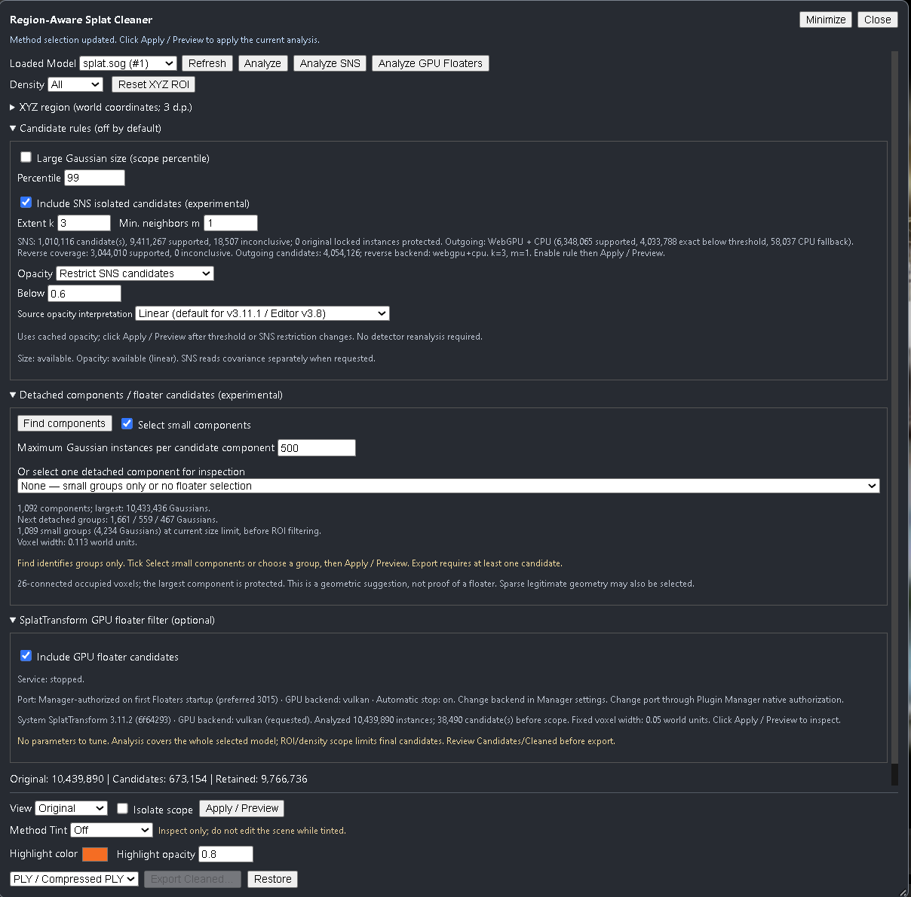
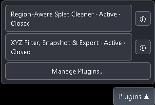

# Editor Plugin Manager

A lightweight extension framework for [PlayCanvas SuperSplat Editor](https://github.com/playcanvas/supersplat), supporting independent plugin development and management **without modifying upstream TypeScript or rebuilding the Editor for each plugin update**.

**Versions:** Plugin Manager **v1.11** · Plugin XYZ Filter **v1.0.10** · Plugin Splat Cleaner **v0.3.18**.  
**Editor references:** SuperSplat **v3.7.0**, **v3.8.0** and **v3.8.1**  (reviewed versions, not guaranteed compatibility across releases)   

## Motivation

SuperSplat Editor is a rapidly evolving open-source application. Built on PlayCanvas Engine, it provides capable rendering and editing functionality for 3D Gaussian Splatting (3DGS), including large scenes. However, specialized workflows may require additional tools for spatial inspection, filtering, cleanup, and more.

Implementing these tools through direct modifications to the Editor's source code introduces tight coupling and increases maintenance effort as both plugin and upstream editor versions evolve.

**Editor Plugin Manager adopts a decoupled architecture with clear responsibility boundaries.** It separates persistent plugin management from the Editor's native runtime and allows individual plugins to be developed and maintained independently.

The objective is to reduce upstream maintenance dependencies while preserving customization flexibility and allowing developers to focus on plugin functionality.

## Logical Architecture

~~~mermaid
flowchart TB
    A["SuperSplat Editor Plugin Manager + Plugins"]
    B["Original Static Server"]
    C["Independent Management Backend"]
    D["Shared Plugin Directory"]

    B -->|"Serves"| A
    A -->|"Management API"| C
    B -->|"Reads"| D
    C -->|"Reads / Writes"| D
~~~

- **SuperSplat Editor:** Rendering and editing, with browser-side plugin integration and lifecycle management.
- **Original Static Server:** Serves the Editor and installed plugins.
- **Management Backend:** Handles plugin installation, removal, and persistent settings.
- **Shared Plugin Directory:** Stores installed plugins, manifest, and configuration.

Both servers access the shared plugin directory without direct server-to-server communication.

## Developing Your Own Plugins

Plugins are independently packaged browser modules using a common lifecycle contract.

1. **Create a package** with `plugin.json`, a JavaScript entry point, and required dependencies.
2. **Implement the lifecycle** for activation, opening, and deactivation.
3. **Integrate functionality** through available SuperSplat Editor APIs.
4. **Install and test** through Plugin Manager, including activation, cleanup, and startup behavior.
5. **Update independently** without rebuilding the Editor.

Plugin Manager handles common integration and lifecycle operations. Individual plugins remain responsible for their functionality, dependencies, resource cleanup, and Editor API compatibility.

See **`Editor_Plugin_Developer_Guide_v1.11.md`** for package specifications, lifecycle contracts, and implementation examples.

## Reference Plugins

Two independently maintained plugins demonstrate the framework.

### XYZ Filter, Snapshot & Export

**XYZ Filter** — Coordinate-based 3DGS filtering, orthographic snapshots, selective export, and transformation-aware metadata.

- **XYZ ranges and reversible preview:** Filter in Editor-world coordinates; opening the plugin starts preview and temporarily isolates other models. **Clear filter** restores full ranges and visibility without ending preview; **Restore and close** ends preview.
- **Export:** Save filtered PLY, compressed PLY, SPLAT, SOG, or SPZ with an `.export.json` report.
- **Snapshots:** Export orthographic PNG/JSON with camera/projection and applicable section metadata. The main-panel snapshot is unfiltered.
- **Traceability:** Record supported post-load transformations and model metadata where reliable.

With multiple loaded models, select the target explicitly. **Activate XYZ before model import** when transformation tracking is required. Restore and close preview before switching targets.

Documentation: `xyz-filter/README.md`.

### Region-Aware Splat Cleaner

**Splat Cleaner** — 3DGS cleanup using Scale-Normalized Spacing (SNS), SplatTransform GPU Floaters, and complementary cleaning rules.

- **SNS (Hybrid CPU/GPU):** Bidirectional covariance-normalized neighborhood-support detection that uses Gaussian scales and orientations to identify unsupported splats. SNS evaluates geometric support rather than directly measuring rendering quality.
- **GPU Floaters:** Independent SplatTransform **v3.11.2** analysis using a bundled browser runtime.
- **Other rules:** Size, Opacity, and detached-component candidate selection, with XYZ region and density scope.
- **Cached analysis and selection:** Independent analysis results are reused while valid. After the initial **Apply / Preview**, changing enabled methods automatically refreshes the candidate selection; analysis or selection-parameter changes still require manual **Apply / Preview**.
- **Visual inspection:** Preview Original, Candidates, and Cleaned results. **Method Tint** highlights one enabled method at a time in Original or Candidates view, with configurable color and opacity. Candidate selection may include legitimate scene details.

Documentation: `splat-cleaner/README.md`.

## Installation and Startup

**Prerequisites:** Node.js/npm, Git for initial checkout, and a compatible browser.

### 1. Prepare Files

Extract the Manager and complete plugin packages alongside the supplied Windows maintenance scripts:

~~~text
release_plugin_manager_v1.11/
├── plugin-manager/
├── xyz-filter/
├── splat-cleaner/
├── supersplat/              # cloned or existing checkout
├── maintain_editor.bat
├── maintain_editor.ps1
├── deploy_runtime.ps1
├── start_architecture_c.ps1
├── run_supersplatEditor_p3013.bat
└── stop_supersplatEditor_p3013.bat
~~~

The Splat Cleaner installable package must include the compiled `vendor/splat-transform-filter.mjs`. Its runtime can be built independently using customized SplatTransform Filter Bridge Builder v1.0.3; building it is not required when installing a complete plugin release.

### 2. Build and Start

Prepare the Editor using the supplied Windows maintenance scripts from the project root:

~~~powershell
.\maintain_editor.bat clone     # first checkout only
.\maintain_editor.bat build
~~~

Choose one of the following startup methods.

#### Option A — Windows launch scripts

~~~powershell
.\run_supersplatEditor_p3013.bat
~~~

Opens **http://127.0.0.1:3013/** automatically.

Press any key in the launch terminal to stop both services, or run:

~~~powershell
.\stop_supersplatEditor_p3013.bat
~~~

#### Option B — Windows custom ports

Start both services, for example on ports 3023/3014:

~~~powershell
powershell.exe -NoProfile -ExecutionPolicy Bypass -File .\start_architecture_c.ps1 -Action start -EditorPort 3023 -ManagementPort 3014
~~~

To stop:

~~~powershell
powershell.exe -NoProfile -ExecutionPolicy Bypass -File .\start_architecture_c.ps1 -Action stop -EditorPort 3023 -ManagementPort 3014
~~~

#### Option C — Manual startup (Windows, Linux, macOS)

Requires an already built and deployed Editor with Node.js dependencies installed on the respective platform.

**Terminal 1 — Editor static server (from project root):**

~~~bash
cd supersplat
npm run serve -- -l tcp://127.0.0.1:3023 --no-port-switching
~~~

**Terminal 2 — Management backend (from project root):**

~~~bash
node ./supersplat/dist/runtime/management-server.cjs --dist ./supersplat/dist --port 3014 --editor-origin http://127.0.0.1:3023
~~~

Open **http://127.0.0.1:3023/**.

Press **Ctrl+C** in each terminal to stop both services.

**Port configuration:**

- The Editor port must match `--editor-origin`.
- When changing the management port, update `data-management-origin` in `supersplat/dist/index.html` accordingly.
- Both ports must be available and different.
- Use separate distributions and plugin stores for concurrent instances.

Stop both services before running maintenance.

### 3. Install Plugins

Open **Plugins → Manage Plugins → Install Plugin**, select the complete plugin folder, and choose **Activate**.

Optionally enable **Startup** and **Save**. Open the plugin from the **Plugins** menu.

Install plugins through the Manager UI, not by manually copying files into `dist/plugins/`.

## Maintenance and Compatibility

| Operation | Procedure |
|---|---|
| Rebuild Editor and deploy Manager | `maintain_editor.bat build` |
| Deploy Manager changes | `maintain_editor.bat copy` |
| Update plugin | Deactivate → Remove → Install → Activate |
| Restore backend access | Restart backend → Refresh |

Removing a plugin resets its saved settings and Startup preferences.

Use trusted plugins and keep the management backend on a trusted local machine. Upstream Editor API changes and browser/WebGPU compatibility may require plugin updates.

## Documentation

- **Plugin development:** `Editor_Plugin_Developer_Guide_v1.11.md`
- **XYZ Filter document:** `xyz-filter/README.md`
- **Splat Cleaner document:** `splat-cleaner/README.md`

---

**Scope:** Independent plugin management and runtime integration for SuperSplat Editor, demonstrated by two specialized 3DGS editing plugins.