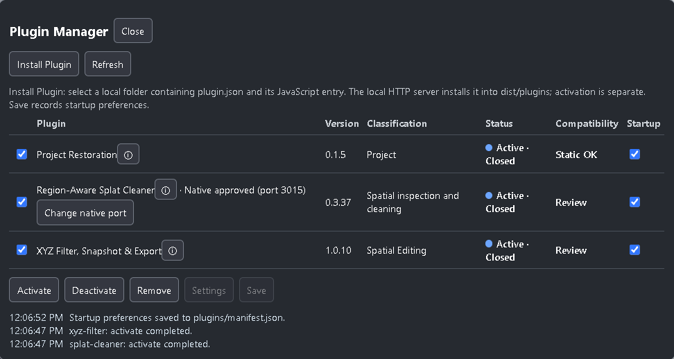

# Editor Plugin Manager v1.13.3

A lightweight extension framework for [PlayCanvas SuperSplat Editor](https://github.com/playcanvas/supersplat), enabling independent plugin development and management **without modifying upstream TypeScript or rebuilding the Editor for each plugin update**.

**Plugin Manager:** v1.13.3  
**Reference plugins:** XYZ Filter v1.0.10 · Splat Cleaner v0.3.37  
**Editor references:** SuperSplat v3.7.0–v3.9.1

## Motivation

Specialized 3D Gaussian Splatting (3DGS) workflows often require additional inspection, filtering and processing tools.

Direct integration into the Editor source increases maintenance effort as upstream development evolves.

Editor Plugin Manager separates plugin development and management from the upstream Editor, improving maintainability, software reuse and implementation flexibility.

## Features

- **Independent plugins:** Install, configure, activate, remove and update plugins without rebuilding the Editor.
- **Persistent configuration:** Manage plugin settings and automatic startup.
- **Native software integration:** Extend browser functionality using existing system CLI tools, libraries and processing scripts.
- **Managed native execution:** Authorization, port assignment, process lifecycle and resource cleanup coordination.
- **Reusable architecture:** Develop specialized plugins through common integration and lifecycle interfaces.

## Architecture

~~~mermaid
flowchart TB
    A["SuperSplat Editor + Plugins"]
    B["Original Static Server"]
    C["Independent Management Backend"]
    D["Shared Plugin Directory"]
    E["Optional Plugin-Owned Native Service"]
    F["System CLI / Libraries / Scripts"]

    B -->|"Serves"| A
    A -->|"Management API"| C
    B -->|"Reads"| D
    C -->|"Reads / Writes"| D
    C -->|"Managed lifecycle"| E
    A -->|"Plugin-specific requests"| E
    E --> F
~~~

The original Editor server remains independent of the management backend.

Plugins can operate entirely within the browser or integrate native processing through their own local services. Plugin Manager handles common infrastructure rather than plugin-specific computation.

This allows existing software to complement browser-based visualization without unnecessary reimplementation.

## Reference Plugins

### XYZ Filter, Snapshot & Export

Coordinate-based filtering and spatial inspection of 3DGS models.

- Interactive XYZ filtering with reversible preview.
- Selective model export.
- Orthographic snapshots with camera and section metadata.
- Transformation-aware export reports.

Documentation: [XYZ Filter](xyz-filter/README.md).

### Region-Aware Splat Cleaner

Interactive 3DGS cleaning through complementary detection methods.

- **SNS:** Bidirectional, scale-normalized geometric-support detection.
- **GPU Floaters:** Contribution-based filtering using system SplatTransform.
- **Additional rules:** Size, Opacity and detached components.
- **Region-aware selection:** XYZ bounds and density scope.
- **Visual inspection:** Original, Candidates and Cleaned views, with individual Method Tint.
- **Selective export:** Retained Gaussians with a JSON cleaning report.

Documentation: [Splat Cleaner](splat-cleaner/README.md).

## Installation and Startup

**Requirements:** Node.js/npm, Git for initial checkout, Windows PowerShell for the Windows workflow, and a compatible browser.

Extract the Manager and complete plugin packages alongside the supplied maintenance and startup scripts.

### 1. Prepare the Editor

From the project root:

~~~powershell
.\maintain_editor.bat clone
.\maintain_editor.bat build
~~~

Clone is required only for the initial checkout.

For an existing compatible Editor build, deploy Manager without rebuilding:

~~~powershell
.\maintain_editor.bat copy
~~~

### 2. Start the Editor

~~~powershell
.\run_supersplatEditor_p3013.bat
~~~

Opens http://127.0.0.1:3013/ automatically.

Press any key in the launch terminal to initiate shutdown, or run:

~~~powershell
.\stop_supersplatEditor_p3013.bat
~~~

Alternatively, use the Node.js launcher with an already prepared Editor:

~~~bash
node editor_services.mjs start
node editor_services.mjs stop
~~~

Custom ports, manual startup and portable deployment are covered in the Maintenance Guide. Portable deployment additionally requires globally installed npm `serve`.

### 3. Install Plugins

1. Open **Plugins → Manage Plugins → Install Plugin**.
2. Select the extracted plugin folder.
3. Activate the plugin.
4. Optionally enable Startup and save.
5. Open the plugin from the Plugins menu.

### Optional GPU Floaters Runtime

GPU Floaters requires system-installed SplatTransform. The evaluated version is v3.11.2.

~~~powershell
npm install -g @playcanvas/splat-transform@3.11.2
splat-transform --version
~~~

On first execution, authorize the native service and select an available port.

On Windows, computation runs automatically in a separate PowerShell window using Vulkan by default.

Other Cleaner methods do not require SplatTransform.

## Developing Your Own Plugins

Plugins are independently packaged extensions containing metadata, a JavaScript entry point and required dependencies.

Plugin Manager provides common lifecycle, configuration and optional native-service interfaces. Developers remain responsible for plugin functionality and Editor API compatibility.

See the Plugin Developer Guide for package specifications and implementation examples.

## Maintenance

| Operation | Procedure |
|---|---|
| Rebuild Editor | `maintain_editor.bat build` |
| Update Manager runtime | `maintain_editor.bat copy` |
| Update plugin | Deactivate → Remove → Install → Activate |
| Restore backend access | Restart backend → Refresh |
| Change native port | Manager → Change native port |

Stop running services before maintenance. Install only trusted plugins and keep local services bound to loopback.

## Compatibility

Standard and portable Windows deployments have been successfully operated with SuperSplat v3.9.1, PlayCanvas Engine v2.24.1 and Cleaner v0.3.37.

Other Editor versions, platforms and GPU environments require separate compatibility verification.

## Documentation

- **Plugin Developer Guide** — Plugin development and integration contracts.
- **[XYZ Filter](xyz-filter/README.md)** — Spatial filtering, snapshots and export.
- **[Splat Cleaner](splat-cleaner/README.md)** — Geometry-aware cleaning and visual inspection.
